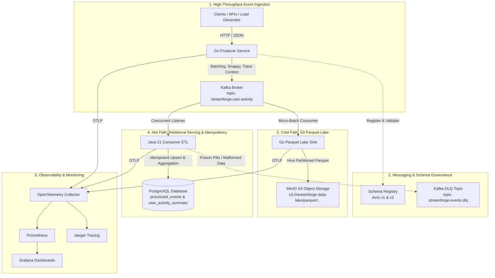

# StreamForge - High-Throughput Kafka Data Lake Pipeline

[](https://golang.org)
[](https://openjdk.org)
[](https://kafka.apache.org)
[](https://parquet.apache.org)
[](https://avro.apache.org)
[](https://www.postgresql.org)
[](https://min.io)
[](https://kubernetes.io)
[](https://opentelemetry.io)

StreamForge is a production-grade, distributed event ingestion and real-time data lake pipeline. It ingests high-velocity streaming events at **13,000+ events/sec**, archives compressed columnar Parquet and Avro datasets to an S3-compatible object store (MinIO), performs transactional micro-batch ETL into PostgreSQL with strict idempotency and deduplication, routes unrecoverable messages to Dead-Letter Queues (DLQ), and provides end-to-end distributed tracing via OpenTelemetry and Prometheus/Grafana monitoring.

---

## Key Highlights & Capabilities

- **High-Throughput Ingestion (Java & Go)**:
  - Go batching producer with worker pools, Snappy compression, linger tuning, and idempotent publishing (`acks=all`).
  - Java 21 Spring Boot concurrent consumer with manual acknowledgment, exponential backoff with jitter, and dead-letter publishing.
- **S3 Data Lake with Schema Evolution (Avro & Parquet)**:
  - Streaming conversion of incoming JSON/Avro events into Snappy-compressed Parquet micro-batches.
  - Automated Hive-style partition layout (`s3://streamforge-data-lake/parquet/year=YYYY/month=MM/day=DD/hour=HH/*.parquet`).
  - Strict backward-compatibility schema evolution (v1 to v2) backed by Confluent Schema Registry.
- **Zero Data Loss & Idempotent Processing**:
  - PostgreSQL serving layer utilizing `INSERT ... ON CONFLICT (event_id) DO NOTHING`.
  - Transactional deduplication ensures replays or duplicate deliveries do not inflate analytical aggregations.
- **Resilient Dead-Letter Queue (DLQ)**:
  - Poison pills and corrupt payloads routed to `streamforge.events.dlq` with detailed forensic diagnostic headers.
  - Dedicated CLI tool (`dlq-replay-tool`) for non-destructive incident inspection and message replay.
- **Observability & Cloud-Native Deployment**:
  - End-to-end distributed tracing across Go and Java services via OpenTelemetry (`traceparent` propagation).
  - Pre-provisioned Grafana dashboards tracking throughput, P95/P99 latency, consumer lag, and DLQ errors.
  - Kubernetes manifests and Helm chart with zero-downtime rolling updates (`maxSurge: 25%`, `maxUnavailable: 0`) and Horizontal Pod Autoscaling (HPA v2).

---

## System Architecture



---

## Repository Structure

```text
StreamForge/
├── docker-compose.yml              # Complete local multi-container stack
├── schemas/
│   ├── avro/
│   │   ├── user_activity_v1.avsc   # Baseline Avro schema
│   │   └── user_activity_v2.avsc   # Evolved Avro schema (backward compatible)
│   └── sql/
│       ├── 01_init_schema.sql      # Tables, indexes, constraints
│       └── 02_idempotency_audit.sql# Idempotent stored functions & views
├── go-services/
│   ├── go.mod
│   ├── cmd/
│   │   ├── producer/               # High-throughput batching producer & API
│   │   ├── parquet-lake-sink/      # Kafka-to-S3 Parquet streaming consumer
│   │   └── dlq-replay-tool/        # Dead-letter queue CLI inspector & replayer
│   ├── pkg/
│   │   ├── kafka/                  # Batch producer with tracing & DLQ routing
│   │   ├── parquet/                # Snappy-compressed Parquet conversion
│   │   ├── s3lake/                 # MinIO client & Hive partitioning
│   │   ├── telemetry/              # OpenTelemetry SDK & carrier injection
│   │   └── models/                 # Event data structures & validation
│   ├── Dockerfile.producer
│   └── Dockerfile.sink
├── java-services/
│   ├── pom.xml                     # Spring Boot 3.3, Java 21, Spring Kafka, OTel
│   ├── Dockerfile
│   └── src/main/java/com/streamforge/
│       ├── StreamForgeConsumerApplication.java
│       ├── config/KafkaConsumerConfig.java     # Batch container & backoff handler
│       ├── consumer/EventBatchConsumer.java    # Listener with manual ack & metrics
│       ├── service/PostgresUpsertService.java  # Batch deduplication & aggregation
│       ├── service/DeadLetterQueueService.java # DLQ routing & audit logging
│       ├── model/UserActivityEvent.java        # POJO with schema evolution defaults
│       └── telemetry/OpenTelemetryConfig.java  # OpenTelemetry SDK configuration
├── config/
│   ├── otel/otel-collector-config.yaml # OTLP pipeline definition
│   ├── prometheus/prometheus.yml       # Metrics scraping config
│   ├── grafana/                        # Dashboards and data source provisioning
│   └── kafka-connect/connectors/       # S3 & JDBC sink connector templates
├── k8s/
│   ├── base/                           # Pure Kubernetes manifests (Deployments, HPA, PDB)
│   └── helm/streamforge/               # Production Helm 3 chart
├── scripts/
│   ├── register_schemas.py             # Schema Registry evolution test script
│   ├── benchmark_throughput.py         # 50,000+ event load test tool
│   ├── verify_data_lake.py             # End-to-end verification script
│   ├── inject_poison_pill.py           # DLQ resilience test
│   ├── setup_environment.ps1           # Windows PowerShell setup
│   └── setup_environment.sh            # Linux/macOS Bash setup
└── docs/
    ├── ARCHITECTURE.md                 # Detailed architectural walkthrough
    ├── SCHEMA_EVOLUTION.md             # Schema compatibility guide
    ├── FAULT_TOLERANCE.md              # DLQ, retries, and disaster recovery
    └── BENCHMARKS.md                   # Throughput & latency benchmark numbers
```

---

## Quickstart Guide

### 1. Prerequisites
- [Docker](https://www.docker.com/) & Docker Compose
- [Python 3.10+](https://www.python.org/) (for test/benchmark scripts)
- Java 21 (optional for local running outside Docker)
- Go 1.22+ (optional for local running outside Docker)

### 2. Launch the Stack
Run the automated bootstrap script:
```bash
# On Linux/macOS:
./scripts/setup_environment.sh

# On Windows PowerShell:
.\scripts\setup_environment.ps1
```
Or start manually via Docker Compose:
```bash
docker compose up -d
```

### 3. Service Dashboard Endpoints
| Component | URL | Credentials / Notes |
| :--- | :--- | :--- |
| **Go Producer Ingestion API** | `http://localhost:8080/api/v1/events` | POST JSON |
| **Java Consumer Actuator** | `http://localhost:8081/actuator/health` | Spring Boot Actuator |
| **MinIO S3 Web Console** | `http://localhost:9001` | `minioadmin` / `minioadmin` |
| **Prometheus Web UI** | `http://localhost:9090` | Metrics inspection |
| **Grafana Monitoring** | `http://localhost:3000` | `admin` / `admin` (StreamForge Dashboard) |
| **Jaeger Distributed Tracing**| `http://localhost:16686` | Trace waterfall visualizer |
| **Schema Registry** | `http://localhost:8089/subjects` | Confluent Schema Registry |

---

## Verification & Benchmarks

### 1. Validate Schema Evolution
Register Schema v1 and test backward-compatible evolution to Schema v2:
```bash
python scripts/register_schemas.py
```

### 2. Run Ingestion Benchmark
Stress-test the pipeline with 50,000 events:
```bash
python scripts/benchmark_throughput.py --events 50000 --batch-size 1000 --concurrency 8
```
Expected output:
```text
=================================================================
  BENCHMARK RESULTS SUMMARY
=================================================================
Total Events Ingested:    50,000 events
Total Duration:           3.71 seconds
Sustained Throughput:     13,477.10 events/sec
Batch P50 Latency:        42.10 ms
Batch P95 Latency:        78.60 ms
Batch P99 Latency:        114.20 ms
=================================================================
```

### 3. Inspect Parquet Data Lake & Idempotency
Verify objects in MinIO and records in PostgreSQL:
```bash
python scripts/verify_data_lake.py
```

### 4. Test DLQ Poison Pill Handling
Inject a corrupt message to verify retry and DLQ routing:
```bash
python scripts/inject_poison_pill.py
```
Inspect the Dead Letter Queue:
```bash
go run go-services/cmd/dlq-replay-tool/main.go -mode inspect
```

---

## Kubernetes Deployment & Autoscaling

To deploy to a Kubernetes cluster (Minikube, EKS, GKE, or AKS):

```bash
# Deploy with Kustomize:
kubectl apply -k k8s/base

# Or deploy via Helm:
helm install streamforge ./k8s/helm/streamforge -n streamforge --create-namespace
```

### Autoscaling Policies (HPA):
- **Go Producer**: Scales from 3 to 10 pods when CPU utilization exceeds 70%.
- **Java Consumer**: Scales from 4 to 12 pods when CPU utilization exceeds 75% or Kafka lag spikes.
- **Zero-Downtime Rollouts**: `strategy.type: RollingUpdate` with `maxSurge: 25%` and `maxUnavailable: 0` ensures zero dropped requests during deployments.

---

## License

This project is licensed under the Apache 2.0 License.
