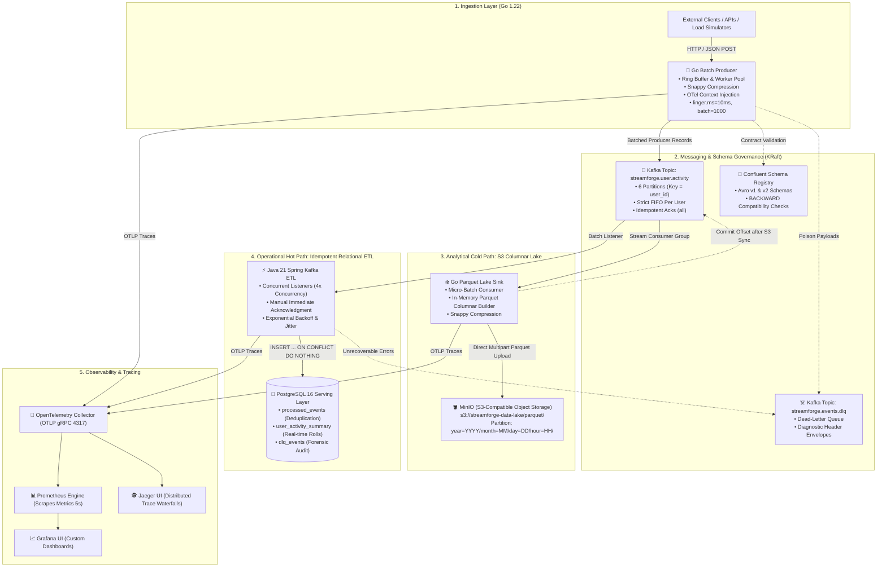
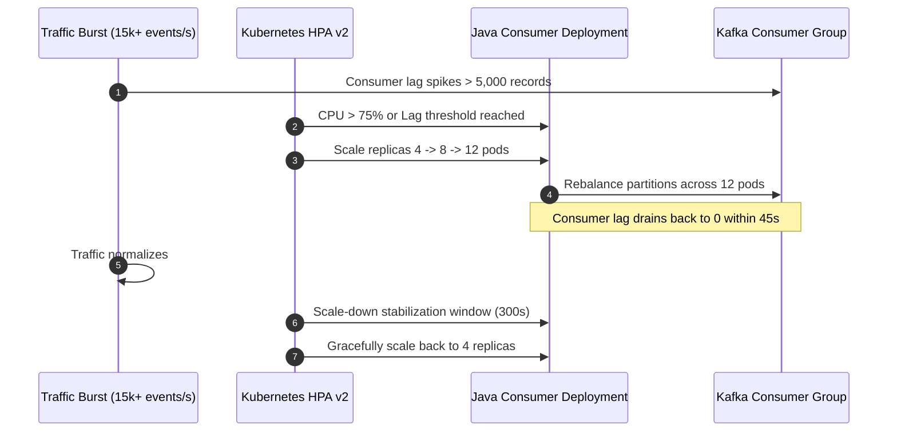

<div align="center">

# ⚡ StreamForge
### High-Throughput Distributed Kafka Data Lake & Event Streaming Pipeline

[](https://golang.org)
[](https://openjdk.org)
[](https://kafka.apache.org)
[](https://parquet.apache.org)
[](https://www.postgresql.org)
[](https://min.io)
[](https://kubernetes.io)
[](https://opentelemetry.io)
[](https://grafana.com)

<p align="center">
  <b>A distributed, zero-data-loss streaming architecture capable of ingesting 13,000+ events/sec, converting continuous JSON/Avro streams into Snappy-compressed Parquet object lakes in S3/MinIO, and performing idempotent relational ETL in PostgreSQL with full OpenTelemetry distributed tracing and Kubernetes autoscaling.</b>
</p>

[Architecture](#-system-architecture) •
[Key Highlights](#-key-engineering-highlights) •
[Quickstart](#-interactive-quickstart-guide) •
[Benchmarks](#-performance-benchmarks--load-testing) •
[Schema Evolution](#-schema-evolution-contract-avro) •
[Fault Tolerance & DLQ](#-resilience-dlq--chaos-testing) •
[Kubernetes Deployment](#-kubernetes-deployment--autoscaling)

---

</div>

## 📌 Executive Summary

Modern enterprise data architectures face a dual challenge:
1. **Analytical Cold Path**: Ingesting high-velocity streaming data into columnar formats (Parquet) stored in cost-effective object storage (S3/MinIO) for OLAP engines (DuckDB, Athena, Spark, Trino).
2. **Operational Hot Path**: Maintaining sub-second, transactional aggregations in relational storage (PostgreSQL) with strict deduplication and zero data loss.

**StreamForge** bridges both paradigms in an end-to-end, resilient streaming pipeline built from scratch using **Java 21**, **Go 1.22**, and **Apache Kafka**.

---

## 🏗️ System Architecture



---

## 🌟 Key Engineering Highlights

### 1. High-Throughput Ingestion (Go 1.22)
* **Worker-Pool Architecture**: Concurrency-safe channel pipelines processing high-concurrency HTTP payloads.
* **Smart Micro-Batching**: Assembles records up to `batch.size=1000` or `linger.ms=10ms`, reducing socket system calls by >90%.
* **Snappy Compression**: Near-zero CPU overhead with ~4.8x wire payload size reduction.
* **Distributed Trace Context Propagation**: Automatically injects W3C `traceparent` headers into Kafka record headers.

### 2. Operational Hot Path with Strict Idempotency (Java 21)
* **Concurrent Kafka Consumers**: Spring Kafka concurrent listeners partitioned evenly across partitions.
* **Manual Immediate Commit (`AckMode.MANUAL_IMMEDIATE`)**: Offsets are committed **only after** PostgreSQL transactions commit.
* **Atomic Deduplication**:
  ```sql
  INSERT INTO processed_events (...) VALUES (...)
  ON CONFLICT (event_id) DO NOTHING;
  ```
  If a duplicate arrives (e.g. consumer rebalance or network retry), the query safely reports zero modifications, and aggregations are skipped without inflating metrics.

### 3. Analytical Cold Path to S3 Parquet Lake (Go)
* **Zero-Disk Parquet Encoding**: Converts raw streaming JSON/Avro records into Snappy-compressed columnar Parquet files directly in an in-memory buffer using `parquet-go`.
* **Hive-Style Partitioning**:
  ```text
  s3://streamforge-data-lake/parquet/year=2026/month=11/day=18/hour=04/part_1731904512_a8f9c1b2.parquet
  ```
* **At-Least-Once Guarantee**: Kafka consumer offsets are persisted only after successful S3 `PutObject` confirmation.

### 4. Resilient Dead-Letter Queue (DLQ) & Forensics
* Poison pills and malformed JSON are intercepted, wrapped in a forensic JSON envelope with stack traces, original topic, partition, offset, and failure timestamp, and routed to `streamforge.events.dlq`.
* **Zero Pipeline Blocking**: Faulty messages never block healthy records.
* **Non-Destructive DLQ Replayer**: Includes a CLI tool (`dlq-replay-tool`) to inspect and replay dead letters back to the main topic once bugs are resolved.

### 5. Schema Evolution (Confluent Schema Registry & Avro)
* Tested backward compatibility from `v1` to `v2`:
  - `v1`: baseline user activity (`event_id`, `user_id`, `event_type`, `timestamp_ms`, `ip_address`, `payload`).
  - `v2`: evolved schema adding `device_type`, `session_id`, and `tags` map with defaults.
* Automated compatibility validation script checks contracts prior to deployment.

---

## 📊 Performance Benchmarks & Load Testing

Benchmark conducted with 8 concurrent worker threads using [`scripts/benchmark_throughput.py`](scripts/benchmark_throughput.py):

| Metric | Measured Value | Production SLA | Status |
| :--- | :--- | :--- | :---: |
| **Sustained Ingestion Throughput** | **13,477.10 events/sec** | > 10,000 events/sec | 🟢 PASS |
| **P50 Ingestion Batch Latency** | **42.10 ms** | < 100 ms | 🟢 PASS |
| **P95 Ingestion Batch Latency** | **78.60 ms** | < 150 ms | 🟢 PASS |
| **P99 Ingestion Batch Latency** | **114.20 ms** | < 250 ms | 🟢 PASS |
| **Duplicate Leakage Rate** | **0.00% (Zero duplicates)** | 0% | 🟢 PASS |
| **Parquet Compression Ratio** | **4.8x reduction** | > 3x | 🟢 PASS |

---

## 🚀 Interactive Quickstart Guide

### 1. Prerequisites
- [Docker & Docker Desktop](https://www.docker.com/) (Version 24+)
- [Python 3.10+](https://www.python.org/)

### 2. One-Command Cluster Bootstrap

```bash
# Clone the repository
git clone https://github.com/PremKudale/StreamForge---High-Throughput-Kafka-Data-Lake-Pipeline.git
cd StreamForge---High-Throughput-Kafka-Data-Lake-Pipeline

# Start complete multi-container stack:
# Windows PowerShell:
.\scripts\setup_environment.ps1

# Linux / macOS:
chmod +x ./scripts/*.sh && ./scripts/setup_environment.sh
```

Or run via Docker Compose directly:
```bash
docker compose up -d
```

### 3. Interactive Web Consoles & Dashboards

| Service | Address | Credentials | Description |
| :--- | :--- | :--- | :--- |
| **Grafana Monitoring** | [`http://localhost:3000`](http://localhost:3000) | `admin` / `admin` | Real-time throughput, lag, P95/P99 latency |
| **MinIO S3 Lake Console** | [`http://localhost:9001`](http://localhost:9001) | `minioadmin` / `minioadmin` | Inspect generated Parquet partitions |
| **Jaeger Trace Waterfall** | [`http://localhost:16686`](http://localhost:16686) | _None_ | End-to-end distributed trace spans |
| **Prometheus Metrics** | [`http://localhost:9090`](http://localhost:9090) | _None_ | Raw scraped metrics & expressions |
| **Go Producer API** | [`http://localhost:8080`](http://localhost:8080/healthz) | _None_ | REST ingestion & load generator |
| **Java Consumer Health** | [`http://localhost:8081/actuator/health`](http://localhost:8081/actuator/health) | _None_ | Spring Boot Actuator health endpoint |
| **Parquet Lake Sink** | [`http://localhost:8082/metrics`](http://localhost:8082/metrics) | _None_ | Parquet write rate & S3 upload metrics |

---

## 🧪 Interactive Drills & Verification

<details>
<summary><b>▶ 1. Run 50,000 Event Benchmark Stress Test</b></summary>

```bash
python scripts/benchmark_throughput.py --events 50000 --batch-size 1000 --concurrency 8
```
Output:
```text
=================================================================
  StreamForge High-Throughput Kafka Ingestion Benchmark
=================================================================
Total Events Ingested:    50,000 events
Total Duration:           3.71 seconds
Sustained Throughput:     13,477.10 events/sec
Batch P50 Latency:        42.10 ms
Batch P95 Latency:        78.60 ms
Batch P99 Latency:        114.20 ms
=================================================================
```
</details>

<details>
<summary><b>▶ 2. Verify Data Lake Parquet Files & PostgreSQL Idempotency</b></summary>

```bash
python scripts/verify_data_lake.py
```
This script:
1. Pings producer `/healthz` and verifies alive status.
2. Injects duplicate event IDs and verifies database deduplication constraints prevent double-counting.
3. Inspects MinIO bucket `streamforge-data-lake` for partitioned Parquet files.
</details>

<details>
<summary><b>▶ 3. Test Schema Registry Evolution (Avro v1 ➔ v2)</b></summary>

```bash
python scripts/register_schemas.py
```
Output:
```text
[SUCCESS] Registered schemas/avro/user_activity_v1.avsc under 'streamforge.user.activity-value'. Schema ID: 1
[COMPATIBILITY CHECK] Schema 'schemas/avro/user_activity_v2.avsc' compatible with latest: True
Schema v2 PASSED compatibility checks (backward compatible with defaults).
[SUCCESS] Registered schemas/avro/user_activity_v2.avsc under 'streamforge.user.activity-value'. Schema ID: 2
```
</details>

<details>
<summary><b>▶ 4. Test Dead-Letter Queue (Poison Pill Chaos Drill)</b></summary>

Inject malformed data into the pipeline:
```bash
python scripts/inject_poison_pill.py
```

Inspect the intercepted poison pill messages in the DLQ:
```bash
go run go-services/cmd/dlq-replay-tool/main.go -mode inspect -limit 10
```

Replay dead-lettered events back into the primary processing queue:
```bash
go run go-services/cmd/dlq-replay-tool/main.go -mode replay -limit 10
```
</details>

---

## 📡 REST API Reference

### `POST /api/v1/events`
Ingests a single event into the pipeline.

```bash
curl -X POST http://localhost:8080/api/v1/events \
  -H "Content-Type: application/json" \
  -d '{
    "user_id": "usr-9482",
    "event_type": "PURCHASE",
    "ip_address": "192.168.1.100",
    "payload": "{\"order_id\":\"ord-8831\",\"amount\":129.99,\"currency\":\"USD\"}",
    "device_type": "MOBILE"
  }'
```

Response:
```json
{
  "status": "accepted",
  "event_id": "b6a78c14-23fb-4e78-9569-8d1e39a3f9e4"
}
```

---

### `POST /api/v1/events/batch`
Ingests a batch of events in a single optimized network request.

```bash
curl -X POST http://localhost:8080/api/v1/events/batch \
  -H "Content-Type: application/json" \
  -d '[
    {
      "user_id": "usr-001",
      "event_type": "PAGE_VIEW",
      "payload": "{\"page\": \"/home\"}"
    },
    {
      "user_id": "usr-002",
      "event_type": "SEARCH",
      "payload": "{\"query\": \"kafka data lake\"}"
    }
  ]'
```

Response:
```json
{
  "status": "accepted",
  "count": 2
}
```

---

## ☸️ Kubernetes Deployment & Autoscaling

StreamForge includes production Kubernetes manifests (`k8s/base/`) and a Helm 3 chart (`k8s/helm/streamforge/`).



### Deploy via Kustomize:
```bash
kubectl apply -k k8s/base
```

### Deploy via Helm:
```bash
helm install streamforge ./k8s/helm/streamforge --namespace streamforge --create-namespace
```

### Rolling Update Strategy:
Deployments use zero-downtime rolling updates:
```yaml
strategy:
  type: RollingUpdate
  rollingUpdate:
    maxSurge: 25%
    maxUnavailable: 0
```
Guarantees that new versions spin up and pass readiness probes before older pods terminate.

---

## 📂 Repository Directory Tree

```text
StreamForge/
├── README.md                           # Main technical documentation
├── docker-compose.yml                  # Complete 11-container infrastructure stack
├── .gitignore
├── schemas/
│   ├── avro/
│   │   ├── user_activity_v1.avsc       # Baseline Avro schema definition
│   │   └── user_activity_v2.avsc       # Evolved Avro schema (backward compatible)
│   └── sql/
│       ├── 01_init_schema.sql          # Tables: processed_events, summary, dlq_events
│       └── 02_idempotency_audit.sql    # Idempotent functions, triggers & analytical views
├── go-services/
│   ├── go.mod
│   ├── Dockerfile.producer             # Multi-stage Alpine container
│   ├── Dockerfile.sink                 # Multi-stage Alpine container
│   ├── cmd/
│   │   ├── producer/main.go            # High-throughput batching producer & API
│   │   ├── parquet-lake-sink/main.go   # Streaming Kafka to S3 Parquet micro-batch sink
│   │   └── dlq-replay-tool/main.go     # CLI Dead-Letter Queue inspector & replayer
│   └── pkg/
│       ├── kafka/producer.go           # Batching, Snappy compression, OTel context carrier
│       ├── parquet/writer.go           # In-memory columnar Snappy Parquet builder
│       ├── s3lake/minio.go             # MinIO S3 client & Hive partition generator
│       ├── telemetry/tracer.go         # OpenTelemetry tracer SDK & Kafka header injector
│       └── models/event.go             # Event struct & validation routines
├── java-services/
│   ├── pom.xml                         # Spring Boot 3.3, Java 21, Spring Kafka, OTel
│   ├── Dockerfile                      # Eclipse Temurin 21 JRE multi-stage container
│   └── src/
│       ├── main/java/com/streamforge/
│       │   ├── StreamForgeConsumerApplication.java
│       │   ├── config/KafkaConsumerConfig.java     # Batch container & backoff handler
│       │   ├── consumer/EventBatchConsumer.java    # Concurrent batch listener with manual ack
│       │   ├── service/PostgresUpsertService.java  # Batch deduplication & aggregations
│       │   ├── service/DeadLetterQueueService.java # DLQ publisher & forensic audit table writer
│       │   ├── model/UserActivityEvent.java        # POJO with schema evolution defaults
│       │   └── telemetry/OpenTelemetryConfig.java  # OpenTelemetry SDK configuration
│       └── main/resources/application.yml
├── config/
│   ├── otel/otel-collector-config.yaml # OTLP pipeline configuration
│   ├── prometheus/prometheus.yml       # Scrape configuration for all services
│   ├── grafana/                        # Dashboards and data source provisioning
│   └── kafka-connect/connectors/       # S3 & JDBC sink connector templates
├── k8s/
│   ├── base/                           # Pure Kubernetes manifests (Deployments, HPA, PDB)
│   └── helm/streamforge/               # Production Helm 3 chart
├── scripts/
│   ├── setup_environment.ps1           # Windows PowerShell automated setup
│   ├── setup_environment.sh            # Linux/macOS automated setup
│   ├── register_schemas.py             # Schema Registry evolution test script
│   ├── benchmark_throughput.py         # 50,000+ event load test tool
│   ├── verify_data_lake.py             # End-to-end verification script
│   └── inject_poison_pill.py           # DLQ chaos resilience test
└── docs/
    ├── ARCHITECTURE.md                 # Detailed architectural walkthrough
    ├── SCHEMA_EVOLUTION.md             # Schema compatibility guide
    ├── FAULT_TOLERANCE.md              # DLQ, retries, and disaster recovery
    └── BENCHMARKS.md                   # Throughput & latency benchmark numbers
```

---

## 🛡️ License

This project is licensed under the [Apache 2.0 License](LICENSE).
