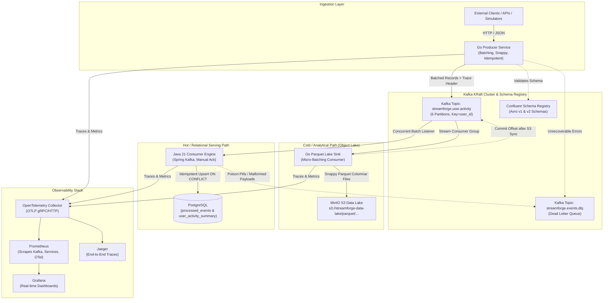

# StreamForge Architecture Deep-Dive

StreamForge is a high-throughput, fault-tolerant distributed event ingestion pipeline and real-time data lake architecture engineered using **Apache Kafka**, **Java 21**, **Go**, **Parquet**, **Avro**, **PostgreSQL**, **MinIO (S3)**, **Kubernetes**, and **OpenTelemetry**.

---

## 1. High-Level Architecture Diagram



---

## 2. End-to-End Data Flow

### A. Ingestion & Partitioning
1. **Producer Batching & Linger**:
   The Go producer aggregates incoming events in an in-memory buffer up to `KAFKA_PRODUCER_BATCH_SIZE=1000` records or `KAFKA_PRODUCER_LINGER_MS=10ms`.
2. **Partitioning Key**:
   Messages are partitioned using `user_id` as the message key. This guarantees strict chronological order of operations for any given user while distributing load evenly across all 6 Kafka partitions.
3. **Trace Context Propagation**:
   The producer creates an OpenTelemetry span and injects the W3C `traceparent` header into the Kafka record headers.

### B. Analytical Storage (MinIO S3 Parquet Lake)
1. **Micro-Batch Buffering**:
   The Go Parquet Lake Sink reads from Kafka into a ring buffer until either 2,000 records or 5 seconds elapse.
2. **Columnar Transformation**:
   The buffered events are converted into Apache Parquet format with Snappy compression using `parquet-go`.
3. **Hive-Style Partitioning**:
   Files are uploaded to MinIO under:
   ```text
   s3://streamforge-data-lake/parquet/year=YYYY/month=MM/day=DD/hour=HH/part_<timestamp>_<uuid>.parquet
   ```
4. **Reliable Commit**:
   Kafka consumer offsets are committed only after the MinIO `PutObject` operation succeeds, ensuring no data loss.

### C. Operational Storage (PostgreSQL Relational Layer)
1. **Concurrency**:
   The Java service utilizes Spring Kafka's `ConcurrentKafkaListenerContainerFactory` with 4 concurrent threads per pod.
2. **Idempotency Strategy**:
   The database schema enforces a primary key constraint on `event_id`:
   ```sql
   INSERT INTO processed_events (...) VALUES (...)
   ON CONFLICT (event_id) DO NOTHING;
   ```
3. **Atomic Aggregations**:
   The PostgreSQL function `process_user_activity_event()` updates continuous real-time aggregations (`user_activity_summary`) only if the row was freshly inserted, preventing inflated totals on message redeliveries.

---

## 3. Observability Architecture
- **Distributed Traces**: Trace IDs flow seamlessly across Go Producer -> Kafka Headers -> Java Consumer / Parquet Sink.
- **Prometheus Metrics**:
  - `streamforge_producer_events_total`: Ingestion throughput broken down by event type.
  - `streamforge_consumer_events_processed`: Ingested vs filtered duplicate count.
  - `streamforge_batch_processing_time_seconds`: Micro-batch processing duration histograms (P50/P95/P99).
  - `streamforge_lake_sink_parquet_bytes_total`: Data lake storage write rate.
