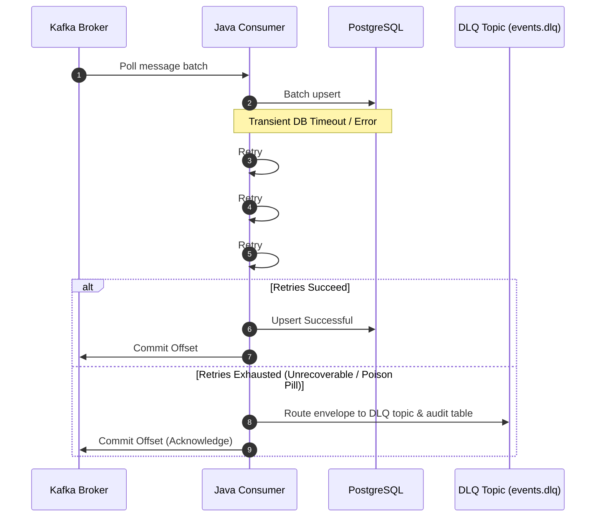

# Fault Tolerance, Retries, and Dead-Letter Queues (DLQ)

StreamForge is engineered for **zero data loss** and high operational resiliency in distributed, unpredictable cloud environments.

---

## 1. Retry Strategy & Exponential Backoff

When transient errors occur (such as momentary database connection timeouts, network blips, or high DB lock contention):



### Configuration in Java Consumer:
```java
ExponentialBackOff backOff = new ExponentialBackOff(1000L, 2.0);
backOff.setMaxInterval(8000L);
backOff.setMaxElapsedTime(25000L);
DefaultErrorHandler errorHandler = new DefaultErrorHandler(recoverer, backOff);
```

---

## 2. Dead-Letter Queue (DLQ) Architecture

Messages that cannot be parsed, fail business validation, or fail after repeated retries are automatically routed to the Dead-Letter Queue topic: `streamforge.events.dlq`.

### DLQ Envelope Schema:
Every DLQ record is wrapped in an audit envelope containing full forensic diagnostics:
```json
{
  "event_id": "evt-777",
  "original_topic": "streamforge.user.activity",
  "partition": 2,
  "offset": 45129,
  "error_message": "Invalid JSON syntax at line 1 column 15",
  "stack_trace": "com.fasterxml.jackson.core.JsonParseException...",
  "retry_count": 3,
  "failed_at": "2026-11-18T04:00:00Z",
  "raw_payload": "{malformed_data...}",
  "processor_host": "streamforge-consumer-pod-x89f",
  "trace_id": "4bf92f3577b34da6a3ce929d0e0e4736"
}
```

### PostgreSQL DLQ Audit Table:
Simultaneously, `DeadLetterQueueService` logs the incident into the `dlq_events` table for immediate inspection by on-call engineers.

---

## 3. Reprocessing & Replay Workflow

Once the underlying issue is resolved (e.g. downstream service patch or schema registration), operators can safely inspect and replay dead letters without restarting services:

```bash
# 1. Inspect unhandled messages in DLQ:
go run cmd/dlq-replay-tool/main.go -mode inspect -limit 50

# 2. Replay verified messages back to the primary topic:
go run cmd/dlq-replay-tool/main.go -mode replay -limit 50
```

---

## 4. Idempotent Processing (Exactly-Once Semantics at Sink)

Because Kafka provides at-least-once delivery, consumer crashes or network retransmissions can redeliver records.

StreamForge guarantees idempotent state updates:
1. **Primary Key Deduplication**:
   `processed_events` table enforces `PRIMARY KEY (event_id)`.
2. **Conditional Metrics Update**:
   Aggregate summaries are updated using the custom PostgreSQL function `process_user_activity_event()`:
   ```sql
   INSERT INTO processed_events (...) VALUES (...)
   ON CONFLICT (event_id) DO NOTHING;
   ```
   If `ROW_COUNT == 0`, the event was already processed, and real-time aggregations (total events, spend) are skipped.

